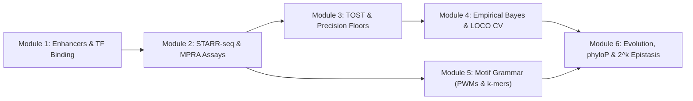

# Free Foundations Curriculum for Paper 2 (*Primate Enhancer FEM*)

This self-paced curriculum is built from **100% free, open-access resources** (zero cost, no journal paywalls) and mapped directly onto each section, equation, table, and figure of [Primate_Enhancer_FEM_v1.1.pdf](../papers/02-primate-enhancer-fem/Primate_Enhancer_FEM_v1.1.pdf). Each module includes a **computing/systems bridge** and a **Paper 3–style self-check** (*"You own this concept when you can explain..."*).

> [!TIP]
> **90-Minute "Fast-Track" Option**: If you want the highest-yield intuition before diving deeper, do just these five items in order:
> 1. **Biology & HARs (25 min)**: Katie Pollard's CARTA/UCTV YouTube talk *"Human Accelerated Regions in the Genome"*.
> 2. **Reporter Assays (15 min)**: StatQuest's *"RNA-seq Normalization / RPKM, FPKM and TPM"* video (same count-ratio logic as MPRA `CPM`).
> 3. **TOST Goalposts (25 min)**: Read the first half of Daniël Lakens's free online [Chapter 9: Equivalence Testing](https://lakens.github.io/statistical_inferences/09-equivalencetest.html).
> 4. **Empirical Bayes Borrowed Variance (15 min)**: Read the baseball shrinkage walkthrough in Irizarry & Love's [Hierarchical Models chapter](https://genomicsclass.github.io/book/pages/hierarchical_models.html).
> 5. **Cross-Validation & ROC-AUC (15 min)**: StatQuest's *"ROC and AUC, Clearly Explained!"* on YouTube.

---

## Learning Roadmap

---

## Module 1: Enhancers, Chromatin, and Transcription Factors
**Unlocks in Paper 2**: *Abstract, Section 1 (billboard vs. shadow enhancers), Study 2B 3D Hi-C loops, and Limitation #1.*

* **Computing Bridge**: Think of a gene's **promoter** as the local power switch right next to a lightbulb, and **distal enhancers** as programmable dimmer modules thousands of DNA letters away that loop through 3D space to touch the promoter when the right combination of **transcription factor (TF)** proteins binds them.
* **Free Resources**:
  1. **Open Textbook (Reading, ~30 min)**: OpenStax *Biology 2e* — [Chapter 16.4: Eukaryotic Epigenetic & Transcriptional Gene Regulation](https://openstax.org/books/biology-2e/pages/16-4-eukaryotic-transcription-gene-regulation) (clean diagrams of enhancers, activators, repressors, and DNA looping).
  2. **Video Lecture (~30 min)**: Science Communication Lab / iBiology — search YouTube for *"Michael Levine Transcriptional Precision in the Drosophila Embryo iBiology"* (classic, plain-spoken visual tour of enhancers and "shadow" backup enhancers by one of the pioneers cited in Paper 2 Refs 14 & 17).
  3. **Short Primer on HARs (~25 min)**: University of California Television (UCTV / CARTA) on YouTube — search *"Katherine Pollard Human Accelerated Regions in the Genome"* (Katie Pollard explains in plain English how HARs were found and why most act as brain developmental enhancers).
* **Self-Check Milestone**:
  * *Why did Paper 2 find (`P2` rejected) that having multiple "shadow" enhancers on the same gene doesn't keep any single enhancer's brightness frozen?* (Because locus-level backups protect the *gene's* output, relaxing evolutionary pressure on each individual enhancer.)

---

## Module 2: How `STARR-seq`, `MPRA`, and `lentiMPRA` Measure Enhancers
**Unlocks in Paper 2**: *Section 2.1 (`CPM` equation), Section 2.2–2.3, Section 3.3, Table 3, and Figure 3B.*

* **Computing Bridge**: An MPRA is a **massively parallel hardware test bench**. Thousands of 171-bp candidate switches are synthesized on a chip; each switch gets ~80 unique 15-bp **hash tags (DNA barcodes)**. When cells transcribe a bright switch into RNA, its barcode appears many times in RNA sequencing. Dividing normalized `RNA counts` by `DNA input counts` gives each switch's gain in `log₂` units (`+1.0 log₂` = `2×` brighter; `±0.15 log₂` = `±11%`).
* **Free Resources**:
  1. **Visual Video on Sequencing Count Normalization (~12 min)**: StatQuest with Josh Starmer (YouTube) — search *"StatQuest RPKM FPKM and TPM Clearly Explained"* and *"StatQuest Logarithms Clearly Explained"* (explains why sequencing counts must be scaled per million reads—`CPM`—and why ratios are analyzed on a `log₂` scale).
  2. **Open-Access Experiment Walkthrough (~30 min)**: Inoue et al. (2017), [*A systematic comparison reveals substantial differences in chromosomal versus episomal encoding of enhancer activity*](https://pmc.ncbi.nlm.nih.gov/articles/PMC5204343/) (PubMed Central `PMC5204343` — Read the Introduction and Figure 1; this is the exact paper from Nadav Ahituv's lab explaining why stitched-in **`lentiMPRA`** is much steadier and more realistic than floating plasmid **`capture-MPRA`**).
  3. **Hands-On Code Peek (~10 min)**: Read lines 33–85 of [reconstruct_har_cohort.py](../validation/reconstruct_har_cohort.py#L33-L85) — ~50 lines of plain Python summing barcodes inside each dish before taking `log₂(CPM_RNA / CPM_DNA)`.
* **Self-Check Milestone**:
  * *Why is treating 80 barcodes inside one petri dish as `N = 80` independent experiments a statistical error ("pseudoreplication")?*

---

## Module 3: Equivalence Testing (`TOST`), Degrees of Freedom, and Precision Floors
**Unlocks in Paper 2**: *Section 2.1, Section 2.4 (`t = 2.920` vs `4.303`), Section 3.2–3.3, Tables 2–3, and Figures 2–3.*

* **Computing Bridge**: Standard hypothesis testing (`H₀: Δ = 0`) is like running a diff check with a noisy sensor and declaring *"files match"* whenever the sensor fails to throw an alarm. **TOST** specifies an engineering tolerance band `(-δ, +δ)` upfront and only certifies **"Equivalent"** when the entire uncertainty interval fits inside the tolerance band.
* **Free Resources**:
  1. **Definitive Free Online Chapter (~45 min)**: Daniël Lakens, *Improving Your Statistical Inferences* — [Chapter 9: Equivalence Testing and Interval Hypotheses](https://lakens.github.io/statistical_inferences/09-equivalencetest.html) (free interactive book by the author of Paper 2 Ref 9; explains why a two-sided **90% confidence interval** corresponds to two one-sided **5% tests**).
  2. **Open-Access Practical Primer (~25 min)**: Lakens (2017), [*Equivalence Tests: A Practical Primer for t Tests, Correlations, and Meta-Analyses*](https://pmc.ncbi.nlm.nih.gov/articles/PMC5502906/) (`PMC5502906` — walks through concrete numerical examples).
  3. **Visual Video on `t`-Distributions & Degrees of Freedom (~15 min)**: StatQuest (YouTube) — search *"StatQuest Confidence Intervals Clearly Explained"* and *"StatQuest Student's t-test"*.
* **Self-Check Milestone**:
  * *With `R = 3` biological dishes (`df = R − 1 = 2`), why did TOST equivalence use `t = 2.920` (90% two-sided CI) while testing whether epistasis `ε` differs from zero at 95% confidence required `t = 4.303`?*
  * *Look at the precision floor inequality `SE(Δ) < δ / t₀.₉₅`: why did `66%–68%` of Girskis `capture-MPRA` switches land in "Inconclusive" even when the tolerance was widened to 2-fold (`δ = 1.0 log₂`)?*

---

## Module 4: Empirical Bayes (`Smyth` Moderation), Clustered Errors, and `LOCO` Validation
**Unlocks in Paper 2**: *Section 2.1 (`s̃²` equation), Section 2.5, Section 3.4, Tables 2, 4 & 5, and Figures 4 & 5.*

* **Computing Bridge**:
  * **Empirical Bayes** is **regularization / smoothing** across parallel channels: 3 samples per enhancer is too tiny to trust raw sample variance alone, so you blend each enhancer's noisy variance with the typical variance measured across all 386 enhancers (`d₀ = 5.66` "virtual prior degrees of freedom").
  * **`LOCO` (Leave-One-Chromosome-Out)** is strict train/test splitting where an entire chromosome is held out as the test set so nearby enhancers cannot leak information.
* **Free Resources**:
  1. **Free Genomics Textbook (~35 min)**: Rafael Irizarry & Michael Love (HarvardX PH525x), *Data Analysis for the Life Sciences* — [Hierarchical Models & Empirical Bayes in Genomics](https://genomicsclass.github.io/book/pages/hierarchical_models.html) (uses intuitive baseball batting averages to explain Gordon Smyth's `limma` variance moderation—the exact equation in Paper 2 Section 2.1).
  2. **Visual Videos on Cross-Validation, Logistic Regression, & `ROC-AUC` (~35 min total)**: StatQuest (YouTube) — search:
     * *"StatQuest Cross Validation Clearly Explained"*
     * *"StatQuest Logistic Regression Clearly Explained"*
     * *"StatQuest ROC and AUC Clearly Explained"* (explains why `0.50` = random guessing, `0.601` = barely above guessing, and `1.00` = perfect separation).
  3. **Plain-English Guide to Clustered Standard Errors (~15 min)**: LOST (Library of Statistical Techniques) — [Cluster-Robust Standard Errors](https://lost-stats.github.io/Model_Estimation/Research_Design/clustered_se.html) (explains why observations grouped by chromosome or gene locus must be clustered so confidence intervals aren't artificially narrow).
* **Self-Check Milestone**:
  * *Why did the percentage of "Equivalent" HARs jump from `43.5%` (raw `df = 2`) to `63.2%` (Empirical Bayes) without a single biological measurement changing?* (Shrinkage pulled noisy 2-df standard errors toward `σ₀ = 0.042` and raised effective degrees of freedom from `2` to `7.66`, shrinking `t` from `2.92` to `1.87`.)

---

## Module 5: Regulatory Sequence Grammar — `IUPAC` Strings vs. `JASPAR` PWMs vs. `gkm-SVM`
**Unlocks in Paper 2**: *Section 2.2–2.3, Section 3.1, Section 3.4 & 3.4.1, Table 5, and Figures 1B & 5.*

* **Computing Bridge**:
  * **IUPAC consensus strings** (`TGANTCA`) are rigid regular expressions (`regex`): a sequence either matches `100%` or `0%`.
  * **Position Weight Matrices (`PWMs` in JASPAR)** are continuous **log₂-odds lookup tables measured in Shannon bits**: at each position `j`, `PWM[base][j] = log₂(P_motif(base) / 0.25)`. Summing across a binding site estimates physical binding energy.
  * **`gkm-SVM`** is a support-vector machine counting all short gapped substrings (*k*-mers, e.g., 10-letter words with gaps) learned directly from open DNA in liver cells without needing a pre-picked list of proteins.
* **Free Resources**:
  1. **Free MIT Open Textbook Chapter (~35 min)**: Manolis Kellis et al., *Computational Biology: Genomes, Networks, and Evolution* (LibreTexts) — [Regulatory Motifs, Gibbs Sampling, and Position Weight Matrices](https://bio.libretexts.org/Bookshelves/Genetics/Computational_Biology_-_Genomes_Networks_and_Evolution_(Kellis_et_al.)) (clear math + intuition for PWMs and log-odds bits).
  2. **JASPAR Official Documentation (~15 min)**: [JASPAR Documentation & FAQ](https://jaspar.elixir.no/docs/) (explains Position Frequency Matrices vs. Position Weight Matrices; try looking up `MA0488.2` `JUN` on https://jaspar.elixir.no to see the exact sequence logo broken in `2xHAR.518`).
  3. **Open-Access `gkm-SVM` Paper Intro (~20 min)**: Ghandi et al. (2014), [*Enhanced Regulatory Sequence Prediction Using Gapped k-mer Features*](https://pmc.ncbi.nlm.nih.gov/articles/PMC4102390/) (`PMC4102390` — read the Author Summary and Figure 1).
* **Self-Check Milestone**:
  * *Why were the 24 IUPAC regex strings completely blind to whether human or chimp glowed brighter (`r = +0.010, p = 0.85`), whereas the 24 JASPAR PWMs caught the direction (`p = 8.4 × 10⁻⁵`) and flagged the `-14.67 bit` `JUN` loss in `2xHAR.518`?*

---

## Module 6: Evolutionary Constraint (`phyloP`), Developmental System Drift, and `2^k` Epistasis
**Unlocks in Paper 2**: *Section 1, Section 2.4, Section 3.4.1, Section 3.5, Table 6, Figures 6 & 7, and the Primary Cohort Study.*

* **Computing Bridge**:
  * **`phyloP`**: A per-base anomaly score comparing observed mutations across hundreds of species to neutral drift (`> 0` = frozen/conserved; `< 0` = evolving *faster* than random drift, i.e., evolutionary acceleration).
  * **Developmental System Drift (`DSD`)**: Refactoring internal source code while passing the exact same input/output integration tests (analogous to DEC rewriting PDP-8 transistor hardware into CMOS while keeping the 12-bit instruction set intact in Paper 1).
  * **`2^k` Hypercubes & Saturating Negative Epistasis**: Testing all `2^9 = 512` binary feature flags between Chimp (`000000000`) and Human (`111111111`). **Negative epistasis (`ε < 0`)** is a **soft-clipping / amplifier saturation curve**: six `+0.08` boosts don't sum linearly to `+0.48` once protein occupancy hits a ceiling—they plateau around `+0.10`.
* **Free Resources**:
  1. **UCSC Genome Browser Conservation Tutorial (~15 min)**: [UCSC Genome Browser Training & Conservation Track Guide](https://genome.ucsc.edu/training/) (explains `phyloP` vs. `phastCons` visually).
  2. **Open-Access Review on Developmental System Drift (~25 min)**: McColgan & DiFrisco (2024), [*Understanding developmental system drift*](https://journals.biologists.com/dev/article/151/20/dev203054/362436/Understanding-developmental-system-drift) (*Development* — crisp open-access primer on DSD; Paper 2 Ref 3).
  3. **Open-Access Review on Epistasis (~30 min)**: Domingo, Baeza-Centurion, & Lehner (2019), [*The Causes and Consequences of Genetic Interactions (Epistasis)*](https://pmc.ncbi.nlm.nih.gov/articles/PMC6858869/) (`PMC6858869` — Figures 1 & 2 give a visual explanation of diminishing-returns / saturating epistasis across biophysical binding curves).
  4. **Primary Open-Access Source Paper (~30 min)**: Whalen, Inoue, Ryu et al. (2023), [*Machine learning dissection of human accelerated regions in primate neurodevelopment*](https://pmc.ncbi.nlm.nih.gov/articles/PMC10023452/) (`PMC10023452` — having finished Modules 1–5, you can read the primary UCSF/Gladstone dataset paper behind Study 2A and Study 3 and follow every figure).
* **Self-Check Milestone**:
  * *In `2xHAR.1` (Figure 6B), why did linear JASPAR motif sums (`+6.69` units) agree with the single-mutation sum (`+0.465`), yet fail to predict that the full 9-mutation human switch stayed nearly equivalent (`+0.129`)?*

---

## Quick-Reference Glossary (Paper 2 Jargon → Plain English)

| Term in Paper 2 | Plain-English Translation |
|---|---|
| **`cis`-regulatory / `*trans*` background** | **`cis`** = encoded on the DNA strip itself; **`trans`** = the cellular soup of proteins reading that DNA (e.g., human cell vs. chimp cell). |
| **`STARR-seq` / `MPRA`** | Lab test wiring thousands of DNA strips to barcoded test lightbulbs to measure brightness via RNA/DNA sequencing counts. |
| **`lentiMPRA` vs. `capture-MPRA`** | **Stitched into chromosomes** (steady, low noise) vs. **floating loose on plasmids** (~24× noisier). |
| **`log₂` fold-change (`Δ`)** | Brightness difference between human and chimp (`0` = identical, `+1` = 2× brighter, `±0.15` = ±11% goalposts). |
| **`TOST` (Two One-Sided Tests)** | Testing whether the entire 90% error bar fits *inside* `(-δ, +δ)` to prove equivalence, instead of misreading `p > 0.05` as "conserved." |
| **Precision floor** | When measurement wobble (`t · SE`) is wider than your goalpost `δ`, making it mathematically impossible to certify equivalence ("Inconclusive"). |
| **Smyth Empirical Bayes (`d₀`, `s₀²`)** | Borrowing typical lab wobble across all 386 switches to stabilize noisy 3-dish variance estimates without changing the average difference `Δ`. |
| **`LOCO` Cross-Validation** | Training a model on 22 chromosomes and testing it on the 23rd held-out chromosome so it cannot cheat by memorizing neighbors. |
| **`ROC-AUC` / `Brier score`** | **`ROC-AUC`**: ranking accuracy from `0.50` (coin flip) to `1.00` (perfect). **`Brier`**: squared probability error (lower is better). |
| **`IUPAC` vs. `PWM` (`JASPAR`)** | Rigid letter-matching regex vs. continuous binding-energy table measured in information `bits`. |
| **`phyloP`** | Base-by-base evolutionary conservation score (`> 0` conserved/frozen; `< 0` faster-than-random mutation / acceleration). |
| **`2^k` hypercube & negative epistasis (`ε < 0`)** | Measuring every single intermediate combination of `k` mutations; **negative epistasis** means combined mutations hit a physical ceiling below their simple sum. |

> [!IMPORTANT]
> **How to use this alongside Paper 3's framework**: After finishing the Fast-Track or Modules 1–6, open [Primate_Enhancer_FEM_v1.1.pdf](../papers/02-primate-enhancer-fem/Primate_Enhancer_FEM_v1.1.pdf) and walk through Figures 1–7 in order—covering the captions with your hand and explaining each panel out loud in your own words. Any panel where you hesitate marks the exact question to bring to a biostatistician or evolutionary geneticist during specialist review.
