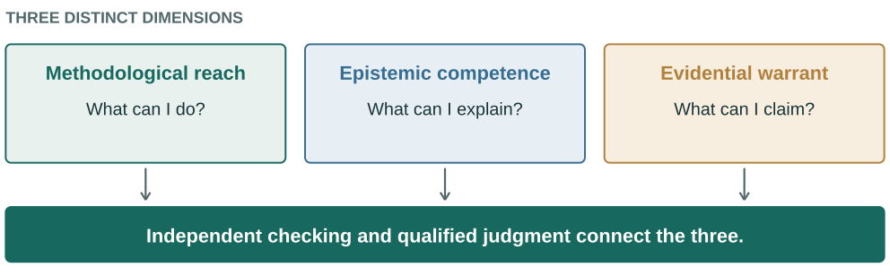
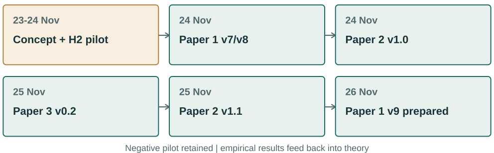
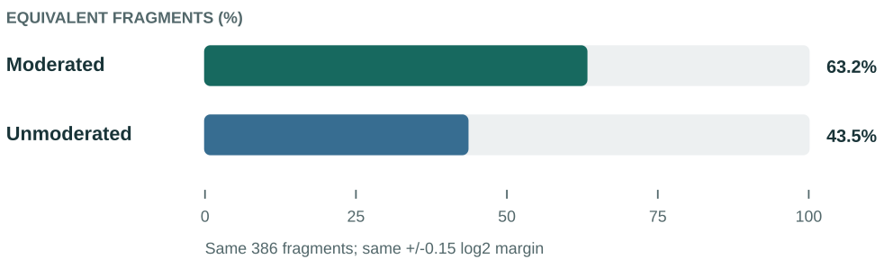
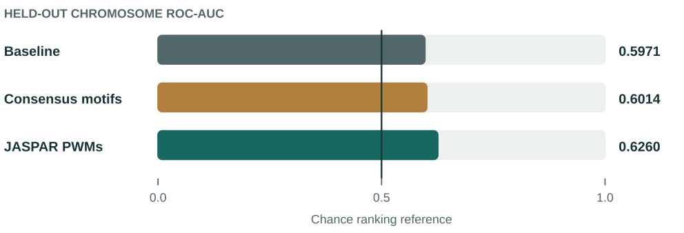
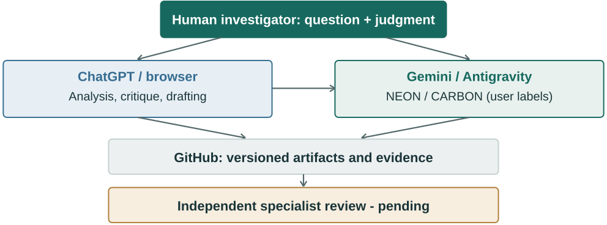
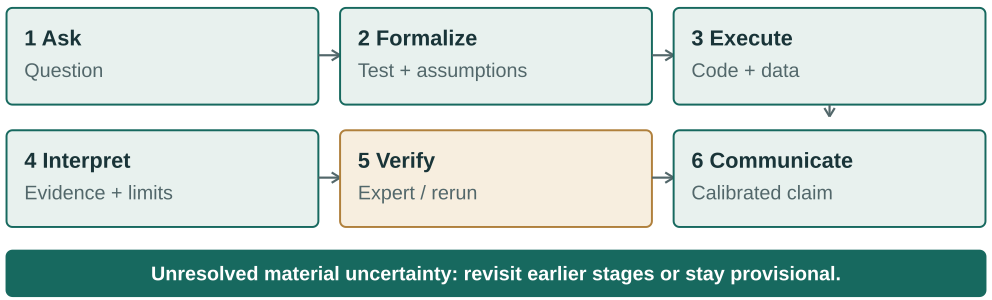

# The Augmented Investigator

## From circuits to genomes: a metacognitive case study of AI-augmented scientific inquiry and epistemic responsibility

Randall S. Young, Ed.S. | Independent Researcher, Indiana, USA  
ORCID: https://orcid.org/0009-0003-1657-0243  
Version 0.3 | 26 November 2026 | Exploratory case study | Not peer reviewed

### Abstract

Generative artificial intelligence (AI) can extend a person's practical capacity to undertake research beyond the methods that person can independently execute or evaluate. This retrospective, single-investigator case study examines a human-directed inquiry that moved from computer architecture to computational regulatory genomics, then to the investigation of its own methods. The evidence comprises selected dated manuscript versions, public repository records, reported computational audits and investigator testimony. The revised record includes a negative genomic pilot, equivalence testing, a cross-platform critique and revision process, an exploratory binding-profile analysis, a statistical correction, and feedback from the empirical work into the theoretical framework. We distinguish methodological reach, epistemic competence and evidential warrant, and propose that recognition of a gap between them should trigger an observable process of learning, independent reproduction and specialist consultation. A multi-AI workflow can produce reviewable artifacts and alternative analyses; agreement between models does not establish scientific truth or replace accountable human review. The case demonstrates a feasible research process and records its unresolved verification burden, not a discovery claim or a causal productivity advantage. We outline a practical framework and a prospective evaluation design for STEM education and metascience.

**Keywords:** artificial intelligence; metacognition; scientific agency; interdisciplinary inquiry; epistemic responsibility; reproducibility; STEM education.

### 1. Introduction

An investigator may understand a question before possessing the expertise required to answer it. AI can assist in translating that question into a model, locating evidence, implementing a computation and drafting a report. These operations can become accessible before their assumptions become intelligible. The resulting problem is not simply how to produce more science, but how to develop understanding and warranted judgment alongside the ability to produce research artifacts.

This paper asks what happens when an investigator notices that gap and responds to it. Its subject is the process of inquiry, not the biological truth of the companion research. The case is useful even if the biological conclusions are subsequently revised or rejected.

<!-- PAGE -->

### 2. Three dimensions of augmented inquiry

Metacognition concerns monitoring and regulation of one's cognitive processes [1]. In AI-assisted scientific work, monitoring must also extend to the origin, quality and limits of reasoning supplied by a tool. Messeri and Crockett [2] identify the danger that greater production can coexist with reduced understanding. The case examined here adds an observable response to that danger: the investigator recognizes uncertainty and asks what to do about it.

**Methodological reach** means the research operations that an investigator can initiate and complete with available tools and assistance. **Epistemic competence** means the capacity to explain the purpose, assumptions, limitations and meaning of those operations, personally or with identifiable qualified support. **Evidential warrant** means how well a specific claim is supported by valid, independently assessable evidence. The three are distinct: a computation can be executable, difficult to explain, and inadequately validated at the same time. Conversely, one may understand a method without possessing sufficient data to use it conclusively.

*Figure 1. Conceptual model, not a quantitative measurement. More reachable methods need not imply greater competence or stronger evidence. Independent verification is the connection that must be built.*

Domain-specific systems such as SciSciGPT demonstrate the potential of integrated, traceable research operations [3]. Brodeur and colleagues' randomized study of quantitative social-science reproduction found no overall superiority of AI-assisted over human-only teams [4]. Neither result warrants extrapolating a productivity advantage to open-ended independent inquiry.

**Research questions.** RQ1: What changes in inquiry scope and maturity can be documented? RQ2: What records indicate a perceived gap between investigative reach and evaluative competence? RQ3: What practices might preserve human agency and accountability? RQ4: How can cross-model critique and version history be made auditable without mistaking them for independent validation?

<!-- PAGE -->

### 3. Materials and methods

This exploratory retrospective N-of-1 case study uses document comparison and first-person reflection. The investigator has formal training in geology and STEM curriculum, additional biological coursework, and professional experience in computing and teaching. He is not presented as a specialist in regulatory genomics or biostatistics. His experience helps explain the choice of analogies and questions, not the validity of the analyses.

The observation window is 23-26 November 2026. The case corpus includes earlier manuscript versions, selected dialogue, the C2G master repository, the architectural-economy repository and the Paper 2 validation index [5-10]. The original draft of the present paper (v0.2) is retained as an earlier interpretive record, not independent corroboration.

**Evidence classes.** A: directly inspectable artifact content or repository record. B: computational results reported in an artifact but not independently re-executed for this study. C: investigator testimony or selected dialogue. D: interpretation, proposed practice or prospective test. Every substantive claim should carry its source, evidence class and remaining uncertainty. A manuscript can be class A evidence that a result was reported, while the result itself is class B.

**Units of analysis.** A research episode is a bounded change in a question, method, result, interpretation or release status. For each episode, record its approximate date, input artifact, action, output artifact, decision and unresolved issue. Attribution is human, AI, joint or unclear; it requires an observable trace, not an inference from model labels or prose style. Dates identify records, not hours spent.

**Scope and verification.** We compare v7 and v8 of Paper 1, v1.0 and v1.1 of Paper 2, the prepared v9 revision of Paper 1, and v0.2 of this paper. At the repository inspection on 26 November, Paper 2 v1.1 and Paper 1 v8 were present; Paper 1 v9 had a revision record but its PDF transfer remained pending. The manuscript review does not rerun the underlying analyses, independently code every prompt, or establish the authenticity of every external execution log. The original full model conversations have not been systematically reconciled.

**Analysis.** We use process tracing to identify turning points: a negative result, a new question, a recognized comprehension gap, a specific correction, a methodological extension, and a revision of theory. The account is intentionally descriptive. There is no preregistered coding, comparator or causal design. The proposed framework is evaluated conceptually against the recorded episodes, not tested as a validated intervention.

<!-- PAGE -->

### 4. Case trajectory: how an analogy became a research program

The initial question concerned the organization of noncoding DNA. Familiarity with the DEC PDP-8 provided an analogy: several physical implementations retained compatible instruction behavior. The analogy did not claim that genomes execute software. It generated a research question about the relationship between a system's implementation and its function.

Paper 1 formalized architectural economy as a trade-off among resource use, reuse and vulnerability. Its computational studies reported 16,384 multiplication checks and 540 synthetic-network comparisons. These counts document the nature and scale of the reported work, not its correctness or importance. The biological question was then operationalized as a prediction that downstream regulatory reach would correlate with sequence conservation.

*Figure 2. Selected artifact milestones, not a continuous time log. The negative pilot is retained. Paper 1 v9 is a prepared revision with transfer pending at the observation cutoff.*

The genomic pilot in Paper 1 did not support the proposed association. Rather than discard that result, the subsequent manuscript distinguished the conservation of DNA sequence from preservation of regulatory activity. It proposed a molecular hypothesis (H3-M), and Paper 2 investigated it using public enhancer measurements. Paper 3, first drafted during this sequence, treats the evolution of the research questions and the investigator's reaction as its own object of study.

The feedback loop matters: a theory can motivate a measurement, and a measurement can constrain the next version of a theory. Neither requires that the theory be correct. The evidence here establishes the existence of such a documented sequence of artifacts; it cannot establish that the same trajectory would have been impossible without AI, or that any one model originated each transition.

<!-- PAGE -->

### 5. Three lessons from the empirical work

#### 5.1 A negative result is useful evidence

Paper 1's K562 pilot reported 636 regions across 408 genes and no robust positive association between regulatory reach and sequence constraint [6]. The held-out prediction error increased when proposed predictors were included. The original expectation was not rescued by a favorable interpretation. The later functional-equivalence question is distinct; it is not a retroactive confirmation of the failed hypothesis.

For a research-methods case study, this is a useful observable decision: retain the unfavorable result, distinguish the failed proxy from the underlying phenomenon, and articulate a new falsifiable question. Whether the initial computation is correct still requires verification.

#### 5.2 A precise number can conceal a methodological choice

Paper 2 reanalyzed public primate enhancer-assay measurements. At the primary reported equivalence margin of +/-0.15 log2 units, 244 of 386 active paired fragments (63.2%) were classified as equivalent with empirical-Bayes variance moderation; the unmoderated analysis classified 168 (43.5%) as equivalent [7,8].

*Figure 3. Reported Paper 2 v1.1 results at the same margin. Equivalence is an assay-level classification; the figure is a transcription of manuscript values, not a new analysis or proof of conservation.*

The essential lesson for the investigator is to ask why the same measurements yield different classifications. Equivalence testing requires the interval to fit within a justified tolerance; failure to find a difference is not sufficient. The tolerance and the statistical model both affect the answer. A person can learn to explain this distinction without independently deriving every estimator. A specialist should still evaluate the implementation, margin and assumptions before the results are used to support a consequential biological claim.

<!-- PAGE -->

### 6. A revision episode: from pattern matching to quantitative models

Paper 2 v1.1 added an explicitly post-hoc audit of transcription-factor binding profiles from JASPAR. In the original analysis, fixed DNA consensus patterns represented binding motifs. The revised analysis used position weight matrices to represent graded sequence preferences. The revised manuscript reports that the richer representation predicts functional equivalence somewhat better on held-out chromosomes; it does not establish directly measured binding affinity or independent external validation [8].

*Figure 4. Paper 2 v1.1, Table 5, all 386 active fragments. ROC-AUC of 0.5 corresponds to chance ranking under a balanced interpretation; 1.0 denotes perfect ranking. Values are reported, not recomputed. The JASPAR extension was post-hoc, and the improvement remains modest.*

The new version also explicitly corrected a statistical ambiguity in the epistasis analysis: with two degrees of freedom, a two-sided 95% t interval uses 4.303, not 2.920. Four of eight selected mutation series reportedly show significant negative nonadditivity under the stricter threshold, while five show nonadditivity at the 90% threshold. These counts are not a population estimate and require a multiplicity and selection audit.

The revision record demonstrates two different activities: (1) a correction to a statistical decision rule and (2) exploration of a different biological representation after examining an earlier result. The former can be checked against a mathematical reference; the latter requires new data or an appropriately controlled validation design to become confirmatory. Treating both as merely "a better result" would obscure the distinction.

The reported raw-barcode reconstruction in v1.1 and the repository validation files are valuable starting points for a reproducibility audit. They establish a record of an attempted check, not independent expert adjudication. This study has not executed those scripts.

<!-- PAGE -->

### 7. Human-directed collaboration across AI environments

The investigator reported working with ChatGPT in a browser and Gemini NEON and CARBON in Antigravity. These are user-supplied environment labels, not independently verified model identifiers. The available exchange documents the sharing of manuscripts, review requests and new versions. The role assignments below describe observed workflow functions and do not assert that one system exclusively performed them.

*Figure 5. Proposed representation of the observed workflow. GitHub carries durable artifacts between sessions; model agreement does not replace the external verification gate.*

A shared repository changes the organization of the work. It provides a common version history, an opportunity to inspect exact files, and a way to preserve negative results and superseded claims. A public index also helps a prospective reviewer identify the current manuscript and the location of the associated code. The C2G repository contained three separate research papers and a validation index at the observation cutoff.

Cross-platform review can generate alternative interpretations, corrections and new tests, as illustrated by the revised motif analysis and epistasis reporting. However, the models may share training material, conventions, assumptions and even copied code. They may also amplify a user's favored framing. Two agreeing responses are therefore not two independent experiments. A model may help construct an independent implementation, but the term "independent" should describe the data path, code, assumptions, execution and reviewers, not the number of chat windows.

An effective handoff should identify the exact input version, requested question, changes proposed, evidence for those changes, and unresolved claims. A version label without a durable artifact is only a claim of a revision. A Git commit proves that particular bytes were archived; it does not certify a calculation or the truth of its prose.

<!-- PAGE -->

### 8. Recognition of the competence gap

The investigator's concern, already recorded in v0.2, was: "I am afraid that AI has found something important, and I don't know exactly what it is?" [9]. This is direct evidence of perceived uncertainty. It is not an objective measurement of ignorance, nor proof that a discovery occurred. The distinction is important: an investigator may be appropriately uncertain precisely because the stakes and specialized methods have become clearer.

The subsequent emphasis was that a lack of understanding does not remove the obligation to obtain help. We preserve the following first-person disclosure from the earlier manuscript, subject to the author's final approval:

> I have reached a point at which I can initiate and obtain computational analyses that I cannot independently perform or fully evaluate. In some aspects of this work, I do not know whether I am making the correct scientific judgments. I cannot yet determine whether the results represent an important discovery, a rediscovery, a methodological artifact or an error. I am not entitled to treat the apparent sophistication of the results as evidence of their validity. My lack of specialist competence does not discharge my responsibility to try to find out. It obliges me to seek qualified assistance, expose the methods and evidence to independent scrutiny, correct mistakes and withhold claims that cannot be adequately supported.

The declaration is not an exemption from scientific responsibility. It is a commitment to a response. An author need not be expert in every operation in a distributed investigation, but should be able to describe the problem, identify what evidence exists, state what is uncertain, and obtain qualified evaluation of consequential inferences. AI tools cannot accept authorship accountability; applicable journal disclosure requirements remain the author's responsibility [11].

**Observable actions.** Identify an uncertainty; translate it into a specific review question; provide the relevant artifact and reproducible procedure; obtain a qualified assessment; record the correction or unresolved disagreement; and revise the claim. The existence of a review plan is not evidence that a reviewer has been recruited or that the concern has been resolved.

This is the central proposition of the paper: expansion of investigative reach can create a duty to develop understanding and obtain support. The recognition of this duty is documented; the effectiveness of the proposed response remains to be evaluated.

<!-- PAGE -->

### 9. An accountable inquiry cycle

The original six-stage framework is retained and extended with a decision gate. The cycle is a proposed operational model, not an experimentally validated learning trajectory.

*Figure 6. Proposed workflow. Unresolved material uncertainty returns inquiry to a relevant earlier stage or leaves the claim provisional; cross-model agreement cannot bypass the gate.*

**Ask.** State the question, motivation and existing knowledge. What observation would matter?

**Formalize.** Define variables, assumptions, alternatives, tolerance and planned test. Can the evidence distinguish the proposed explanations?

**Execute.** Record dataset identifiers, code, environment, model-assisted actions and output hashes. Is the operation inspectable and repeatable?

**Interpret.** Explain estimates, uncertainty, negative findings and alternative interpretations. What claim follows, and what does not?

**Verify and seek help.** Assess the investigator's ability to explain the method; obtain independent reproduction and appropriate specialist scrutiny. If unresolved concerns materially affect the claim, do not promote it to a validated conclusion.

**Communicate and revise.** State the conclusion with scope, limitations, provenance, disclosure and revision history. Preserve the prior version and the reason for each change. A provisional result can be shared explicitly as provisional; verification is not a requirement to suppress open questions.

The decision gate is not a general demand that every author derive every mathematical method. It requires appropriate expertise and proportionality: a numerical result used as a classroom illustration, a research hypothesis and a clinically consequential decision have different validation burdens. The investigator must not confuse a tool's confidence or a polished manuscript with the status of the evidence.

<!-- PAGE -->

### 10. From an idea to an educational practice

Inquiry-based science education emphasizes meaningful questions, observation, explanation and communication [12]. For the augmented investigator, a useful educational principle is experience before equation: start with a phenomenon worth understanding, then use the need for explanation to motivate acquisition of the necessary methods. This differs from using AI to bypass the experience.

Consider a classroom investigation in which students measure the cooling of a cup of water. AI may help them build a graph, fit a model or identify a suspicious measurement. The learner must still explain what was measured, how the thermometer was used, why the model has a particular form, what a residual means, and how another team could test the same claim. A plausible model produced by AI is a hypothesis to confront with data.

The advanced analogue is the enhancer-equivalence case. A learner should be able to explain why "not significantly different" does not mean equivalent, why margin choice matters and why replicates must be independent. An expert can review the statistical implementation. Learning is not measured simply by generating the final report.

**Proposed assessment rubric.** Rate each dimension on a transparent 0-2 scale: 0 = missing or unexplained; 1 = partial with prompting or identifiable help; 2 = clear, evidence-linked explanation or demonstrated action. The six dimensions are question quality, method explanation, evidence interpretation, recognition of limits, independent checking and claim calibration. Use multiple human raters and assess inter-rater agreement before treating scores as reliable.

A student who recognizes an uncertainty and designs a valid test may demonstrate more scientific judgment than one who submits a technically impressive but unexamined answer. AI may broaden access to inquiry, but educational assessment should reward an increasing capacity to reason independently and collaborate responsibly. This paper proposes applications, not evidence of classroom effectiveness; no student participants or classroom trials are reported.

<!-- PAGE -->

### 11. A prospective evaluation of augmented inquiry

The case motivates a testable research design rather than a claim of comparative effectiveness. Recruit consenting investigators with defined prior experience. Assign matched inquiry tasks to human-only, single-AI-assisted and multi-AI-assisted conditions; randomize or counterbalance order, balance access to data and software, and record verification costs. A domain-expert-supported condition could examine whether accountable human consultation improves outcomes beyond model critique. Use equivalent task difficulty and preserve failures.

Specify primary outcomes before data collection: blinded expert ratings of claim validity, correctness of computational procedures, reproducibility and explanation of key assumptions. Secondary outcomes may include time to reviewable artifact, breadth of methods attempted, number and severity of errors detected, time to correct errors, and workload of specialist review. Do not equate word count, manuscript count or number of prompts with quality. Record actual time rather than inferring it from timestamps.

A prospective competence measure could ask each participant to explain a method without the AI, identify an invalid inference in a deliberately flawed result, and design a check. Score the quality of the response separately from task completion. Compare performance before and after feedback. A confidence rating paired with a knowledge assessment could examine calibration, rather than assume that self-reported uncertainty means either lack of understanding or sound judgment.

**Falsification.** The proposed accountability gate should improve the calibration of claims, error correction or reproducibility without unacceptable burden. It would be weakened if gate use failed to change claim quality, if participants treated checklists as substitutes for understanding, or if the time and expertise required made the procedure impractical. Compare the actual benefit and cost rather than assuming the framework must work.

**Limits of the present case.** One experienced investigator, retrospectively selected episodes, incomplete conversation traces, no unaided comparator, no objectively measured comprehension, no independent coding and no full computational re-execution restrict interpretation. There may be missing unsuccessful attempts or preferential retention of productive sessions. The present manuscript is itself AI-assisted and vulnerable to fluent but unwarranted synthesis. Its claims about the research process should be subjected to the same evidential standards it proposes.

<!-- PAGE -->

### 12. Conclusion and declarations

This case documents a transition from an architectural question to empirical computation, then to explicit reflection on the investigator's ability and responsibility to judge the resulting work. The central distinction is between the capability to initiate an investigation and the evidential basis for concluding that its results are valid. AI can assist in closing the implementation gap, but may also expose a gap in understanding. A versioned, human-directed workflow provides a means of organizing the response: retain negative evidence, document changes, separate exploration from confirmation, seek qualified help, and calibrate claims.

Three companion publications serve distinct purposes: a theoretical and computational architectural framework, an empirical molecular reanalysis, and the present methodological case study. Their claims stand or fall independently. The value of investigating the human-AI process does not require the biological reanalysis to be novel or correct. Conversely, the existence of an interesting process does not make its outputs scientifically valid.

The augmented investigator's task is therefore not merely to produce more sophisticated answers. It is to create conditions under which those answers can be understood, challenged, corrected and, where warranted, accepted. Recognizing the need for help is the beginning of that process, not its completion.

**AI assistance and authorship.** ChatGPT assisted with source recovery, organization, illustration and revision of this manuscript. The underlying work reports assistance from ChatGPT and Gemini/Antigravity. Exact model-specific contributions remain incompletely reconstructed. No AI system is an author; final approval of the text and first-person disclosure remains with the human author.

**Evidence and code availability.** The public C2G master archive identifies the manuscripts, versioned research artifacts, validation records and checksums [10]. The associated architectural-economy repository contains computational materials [6]. The present revision provides diagram sources and a rendering script. Selected conversation records remain private; their disclosure would require consent, redaction and applicable permissions. Repository availability is not an execution guarantee.

**Ethics, funding and competing interests.** No new participant recruitment is reported. The investigator is both author and subject. Applicable ethics review, funding, competing interests and permission for future transcript release must be confirmed before submission. No independent human specialist review or peer review is claimed.

<!-- PAGE -->

### References

[1] Flavell JH. Metacognition and cognitive monitoring: A new area of cognitive-developmental inquiry. American Psychologist. 1979;34:906-911. doi:10.1037/0003-066X.34.10.906.

[2] Messeri L, Crockett MJ. Artificial intelligence and illusions of understanding in scientific research. Nature. 2024;627:49-58. doi:10.1038/s41586-024-07146-0.

[3] SciSciGPT: advancing human-AI collaboration in the science of science. Nature Computational Science. 2026;6:301-315. doi:10.1038/s43588-025-00906-6.

[4] Brodeur A, et al. AI-assisted teams outperform AI-led teams but not human-only teams in assessing research reproducibility in quantitative social science. PNAS. 2026. doi:10.1073/pnas.2524747123. See also published correction, PMID 42406974.

[5] Young RS. The Augmented Investigator. Versions 0.1 and 0.2. 24-25 November 2026. Working manuscripts. v0.2: C2G master repository [10].

[6] Young RS. Architectural Economy in Biological and Technological Systems. Versions 7.0, 8.0 and prepared revision 9.0. 24-26 November 2026. Unreviewed manuscripts. https://github.com/RandoSY/architectural-economy and [10].

[7] Young RS. Functional Equivalence Mapping in Primate Enhancer Evolution. Version 1.0. 24 November 2026. Unreviewed manuscript; archived in [10].

[8] Young RS. Functional Equivalence Mapping in Primate Enhancer Evolution. Version 1.1. 25 November 2026. Unreviewed manuscript and reported audit; [10], validation/ and papers/02-primate-enhancer-fem/.

[9] Young RS. Research dialogue with ChatGPT and author-reported Gemini/Antigravity workflow, 23-26 November 2026. Selected private records; complete trace reconstruction pending. The quoted concern and draft disclosure appear in v0.2 [5].

[10] Young RS. From Circuits to Genomes (C2G). Versioned public research repository. Inspected 26 November 2026, commit 222f7e8a05366acd0fdbd7c5b64f700c012b7c23. https://github.com/RandoSY/circuits-to-genomes

[11] International Committee of Medical Journal Editors. Recommendations: AI use by authors; roles and responsibilities of authors and contributors. https://www.icmje.org/recommendations/

[12] National Research Council. Inquiry and the National Science Education Standards: A Guide for Teaching and Learning. Washington, DC: National Academies Press; 2000. doi:10.17226/9596.

**Revision note:** v0.3 adds a dated artifact trajectory, cross-platform workflow, evidence classes, two quantitative illustrations of analytical choices, a revised accountability gate and an expanded prospective evaluation. No new biological calculations were conducted for this paper.
