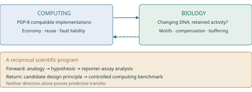
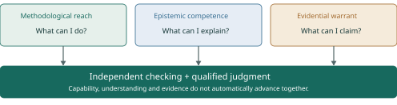
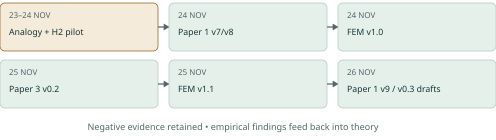
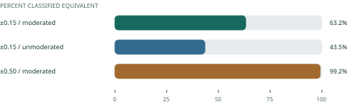
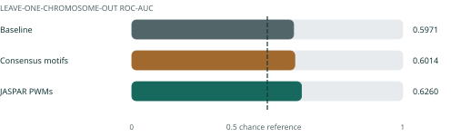
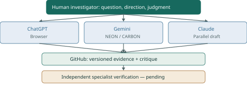
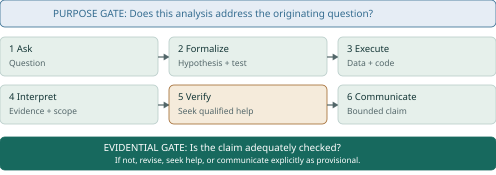

# The Augmented Investigator
## From Circuits to Genomes and Back: a metacognitive case study of AI-augmented scientific inquiry and epistemic responsibility
Randall S. Young, Ed.S. | Independent Researcher, Indiana, USA
ORCID: https://orcid.org/0009-0003-1657-0243
Version 0.6 | 26 November 2026 | Exploratory case study | Not peer reviewed

### Abstract
An investigation motivated by the documented evolution of the DEC PDP-8 developed into an empirical inquiry into biological regulatory continuity despite molecular change. Generative artificial intelligence (AI) assisted the transition from technological observation to cross-domain hypothesis, computational modeling, public-data analysis, and revision. This retrospective single-investigator case study examines how methodological reach can expand faster than the investigator's ability to evaluate evidence and maintain intellectual direction. Selected manuscripts, repository records, and dialogue document negative findings, a reformulated hypothesis, a competence gap, and a second metacognitive episode: the deliberate refusal to let an attractive new question about genomic information capacity eclipse the originating inquiry. The H100 accelerator broadened the comparative perspective from continuity across physical implementations to coordination at large scales; it is not a descendant of the PDP-8. Exploratory CPU models operationalized a potential return direction, without demonstrating H100 performance or biological-to-computing predictive transfer. The case distinguishes methodological reach, epistemic competence, evidential warrant, and continuity of purpose. We extend the six-stage inquiry cycle with a purpose-disposition decision and verification-dependency gate, separating conceptual enrichment from a warranted manuscript change. The investigator retains responsibility for direction, qualified review, and proportionate claims. These records support a descriptive case and prospective evaluation framework, not causal claims of improved productivity, classroom efficacy, or novel biological discovery.

**Keywords:** AI-augmented inquiry; interdisciplinary reasoning; functional continuity; metacognition; scientific agency; reproducibility; STEM education.

### 1. Introduction
The scientific opportunity created by AI is not merely the production of sophisticated answers. It is the ability to pursue a meaningful question across disciplinary boundaries. The corresponding difficulty is retaining the capacity to explain why the methods are relevant, what the evidence justifies, and what remains unknown. This paper investigates that difficulty through the history of one research project. Its subject is inquiry, not a new biological result; the case remains informative even if the companion analyses are later corrected or rejected.
### 2. The golden thread: technology-inspired biological inquiry
The originating observation is asymmetric: documented technological evolution provides an investigative lens for asking whether biology possesses analogous, potentially underappreciated architectural capacities. The investigator subsequently entertained reciprocal illumination, in which biological observations may motivate new computing experiments, but this return direction is an extension rather than the historical origin of the inquiry. The PDP-8 provides a concrete example: compatible instruction behavior persisted across substantial changes in physical hardware. In biology, an analogous question concerns the persistence of regulatory activity despite changes in DNA sequence and molecular interactions. This comparison is analytical, not a claim that organisms execute computer programs or that evolution has an engineer's intent [6,7].

*Figure 1. The originating reciprocal research question. Solid direction: documented development of questions and analyses from computing toward biology. Dashed return direction: a subsequent research ambition, now explored in CPU models; predictive transfer has not been demonstrated. Conceptual schematic.*

The hypothesis-generating value of an analogy is different from its evidential value. A successful analogy helps identify a variable, contrast, or intervention worth testing. A scientifically transferable principle should additionally make a prediction that survives appropriate controls in the recipient domain. Parallel descriptions of robustness are not sufficient. Economic cost, failure, and functional continuity must be defined within each domain; biological fitness costs cannot be equated numerically with memory words or processor cycles.

This distinction supplies a safeguard against intellectual drift. When analytical machinery becomes elaborate, the investigator should be able to identify the chain from the original question to the hypothesis, measurement, result, and bounded inference. A statistically interesting result that cannot be linked to that chain may be valuable research in its own right, but it should not silently replace the original project. Conversely, preserving the question does not mean preserving the expected answer: negative evidence must be allowed to change or defeat the proposed analogy.
### 3. Three dimensions of augmented inquiry
Metacognition concerns awareness and regulation of one's cognitive processes [1]. In AI-assisted research it must also include monitoring the provenance and limits of externally generated reasoning. Messeri and Crockett [2] identify the risk that increasing research production can coexist with illusions of understanding. This case examines an investigator who explicitly recognizes uncertainty rather than treating fluent output as knowledge.

**Methodological reach** is the range of research operations a person can initiate and implement with available assistance. **Epistemic competence** is the ability to explain assumptions, interpret evidence and recognize limitations, personally or with identifiable qualified support. **Evidential warrant** is the degree to which a specific claim is supported by valid, independently assessable evidence. These are analytically distinct, not measured scores. A computation may be executable, difficult to explain, and inadequately validated at the same time.

*Figure 2. Three distinct dimensions of inquiry. The diagram is conceptual; no numerical measure of reach, competence or warrant is inferred from this case.*

Integrated research assistants such as SciSciGPT [3] illustrate the potential for AI-supported research operations. Brodeur et al. [4] reported no overall superiority of AI-assisted over human-only teams in a quantitative social-science reproduction task. Neither observation establishes a comparative advantage in open-ended interdisciplinary inquiry.

**Research questions.** RQ1: How does the original question become testable across domains? RQ2: What changes in scope and perceived evaluative competence are documented? RQ3: How do revision, criticism and negative evidence shape the work? RQ4: What practices preserve intellectual direction, independent verification and human accountability, including the deliberate decision not to revise a manuscript when a new idea is relevant only to its context? RQ5: What would constitute evidence of reciprocal cross-domain transfer rather than an attractive analogy?
### 4. Materials and methods
This is an exploratory, retrospective N-of-1 case study, combining document comparison with first-person reflection. The investigator has formal training in geology and STEM curriculum, additional biology coursework, and professional experience in computing and education. This background explains the choice of questions; it does not establish specialist competence in biostatistics or regulatory genomics.

The selected record covers 23–26 November 2026: Architectural Economy v7, v8 and prepared v9 [6]; Functional Equivalence Mapping (FEM) v1.0 and v1.1 [7]; earlier versions and two parallel v0.3 drafts of this paper [5]; selected dialogue [8]; and the C2G public repository [12]. At an earlier inspection on 26 November, Paper 2 v1.1 was present, while Paper 1 v9 had a revision record but its PDF transfer had not yet been confirmed. The supplied v9 PDF is part of the document evidence regardless of publication status. The present integrated revision uses the v0.4 editable source, the complete v0.5 revision text [18], the Paper 1 v11 source consulted during the later dialogue, the documented FEM-GPU checkpoints, and a selected 26 November exchange on evolutionary tracing, genomic information capacity, and editorial scope [13–17]. The v0.5 additions are incorporated into the main narrative rather than retained as prefatory review pages. The current case analysis does not rerun the underlying pipelines; reported processed-output reproduction is distinguished from independent primary-data reconstruction and specialist review.

We distinguish four evidence classes: (A) directly inspectable artifact content or repository records; (B) computational outcomes reported in those artifacts, but not independently reproduced for this case study; (C) investigator testimony and selected dialogue; (D) interpretation, proposed practices and prospective tests. An artifact may establish that a result was reported without establishing the validity of that result. No missing dialogue, active research hours, exact model identities, or model-specific contributions are imputed.

The unit of analysis is a research episode: a bounded change in question, method, result, interpretation, or release status. A trace record should identify date, input version, action, output, rationale, relation to the originating question, and unresolved concern. Attribution may be human, AI, joint, or unclear, and requires evidence. We compare episodes descriptively, with particular attention to negative findings and narrowed claims. The corpus is incomplete and retrospectively selected; no independent coder, preregistered protocol, or matched unaided comparator is available. The new episode is reconstructed from visible dialogue and contemporaneous artifact records, not inferred mental states. The investigator's explicit editorial disposition is class C testimony; the unchanged Paper 1 decision is not itself evidence for its scientific thesis.

The two parallel v0.3 drafts are themselves artifacts of the workflow. The ChatGPT edition extends the illustrations, evidence classification and multi-AI process description; the Claude edition supplies a focused audit-response table and bounded reviewer questions. The v0.4 baseline integrated those features and the investigator's subsequent instruction to preserve the original reciprocal research ambition. The AI-assisted synthesis is subject to author review and does not itself corroborate the underlying findings.
### 5. Case trajectory: from a question to a program
The PDP-8 analogy led to a theoretical framework about reuse, architectural economy, robustness and compatibility. Paper 1 reports computational benchmarks, including 16,384 multiplication checks and 540 synthetic network comparisons. These illustrate the operationalization of the idea. They are constructed models rather than independent evidence of biological cost or evolutionary optimization [6].

*Figure 3. Selected artifact milestones, not a complete time log. The negative pilot remains part of the record. Paper 1 v9 integrates feedback from Paper 2; no new simulation is claimed for that revision.*

The original H2 genomic pilot asked whether downstream regulatory reach predicted sequence constraint. It reported no robust support in 636 regions across 408 genes; held-out prediction worsened with the new predictors. That result led to a distinction between conservation of molecular components and continuity of functional activity. The subsequent molecular hypothesis H3-M proposed explicit tests of activity equivalence. Paper 2 applies this approach to existing enhancer-assay data. The revised theory in Paper 1 v9 preserves the negative result and narrows what the biological analysis can establish.

The methodological sequence is more important for this paper than the apparent success of any one result. A conceptual model generated a question; an indirect prediction failed; a new measurement was proposed; and the companion evidence returned to constrain the theory. This is a documented route of inquiry, not proof that AI uniquely enabled it. It also provides a test for intellectual continuity: an empirical revision should clarify its relationship to the original question and should be allowed to falsify a proposed connection.

The three papers remain standalone contributions. Paper 1 concerns architectural theory and models, Paper 2 concerns empirical molecular reanalysis, and Paper 3 concerns the research process and its responsibilities. Their association does not make any one manuscript dependent on the truth of another's conclusions.
### 5.1. Two technological lenses, not a single technological lineage
The investigator's later clarification distinguishes two reasons for selecting computing examples. The PDP-8 series supplied the originating observation: successive discrete-transistor, integrated-circuit and single-chip compatible implementations preserved the core instruction contract, subject to peripheral and timing qualifications. The observation suggests that a specified functional interface can persist when its physical realization changes. It does not establish that biological regulation has a comparable interface or that every generation is faster.

The H100, introduced in 2022, broadened the historical comparison across roughly 57 years from the 1965 PDP-8. It is a modern endpoint illustrating massive parallelism, hierarchy, specialization, reuse and coordination at large scale [13,15]. It is not a compatible successor to the PDP-8, and the two devices are not a continuous evolutionary lineage. The investigator sought the accumulated engineering solutions embodied in the accelerator as another source of candidate biological questions about organization, not primarily as a device to accelerate the current genomic analysis.

The analytic affinity is therefore twofold: continuity across implementations and coordination as complexity scales. Both can generate hypotheses for biological study, but neither establishes molecular homology, equivalence of causal mechanisms, or a law of biological evolution. Deliberate engineering and biological evolution have different causal histories. This preserves the original direction of inquiry while making room for carefully tested reciprocal questions.

### 6. Methods serve the question: a worked example
Paper 2 reports that 244 of 386 active human–chimpanzee enhancer fragments (63.2%) met an assay-level equivalence criterion with empirical-Bayes variance moderation, compared with 168 (43.5%) without moderation at the same ±0.15 log₂ margin [7]. An equivalence test asks whether the uncertainty interval fits inside a specified tolerable difference, rather than whether a conventional difference test fails to reject zero. The original frozen protocol used ±0.50 log₂; the tighter primary margin was selected after inspecting assay controls. At the original wider margin, the reported moderated equivalence rate is 99.2%. The full sensitivity grid is therefore essential to interpretation. Biological justification of the tolerance remains open.

*Figure 4. Reported equivalence classifications, not recomputed data. The first two bars use the same tolerance and illustrate statistical model dependence; the third uses the original wider tolerance and illustrates a different decision criterion. Source: FEM v1.1 [7].*

The relevant architectural question is not how to maximize the fraction classified as equivalent. It is whether distinct implementations satisfy a defensible functional requirement, and whether identifiable interactions predict that tolerance. Thus an analyst should explain how a given equivalence bound represents the functional requirement, what uncertainty is present, and why a statistical choice is appropriate. A reporter assay is not a measurement of every endogenous gene-regulatory function; equivalent reporter activity does not demonstrate preserved organismal fitness, causal wiring, or coordinated response.

This example illustrates a general educational distinction: the ability to produce a percentage is not equivalent to understanding the experiment, the decision rule, or the claim. The investigator may acquire the latter understanding through inquiry and specialist assistance; the sophistication of the procedure is not a substitute for either.
### 7. Revision and criticism as evidence of inquiry
FEM v1.1 added an exploratory audit using JASPAR position weight matrices, which represent graded sequence preferences rather than binary consensus patterns. The reported held-out ROC-AUC rose from 0.5971 for the baseline to 0.6260 with JASPAR features. The original consensus-motif model scored 0.6014 [7]. This is modest predictive improvement in the analyzed cohort, not independent evidence of measured molecular binding or an established general predictor. The audit was explicitly post-hoc.

*Figure 5. Reported held-out chromosome ranking performance for all 386 fragments. The dashed reference marks chance ranking (AUC 0.5); 1.0 is perfect ranking. The difference is small, and uncertainty and independent-cohort validation are required. Source: FEM v1.1, Table 5 [7].*

The revised manuscript also distinguishes a two-sided 95% t interval at two degrees of freedom (critical value 4.303) from the 90% interval (2.920). Four of eight selected mutation series reportedly show negative nonadditivity at the stricter threshold; five show nonadditivity at the 90% threshold. These are nominal tests in a selected set, not a prevalence estimate or multiplicity-adjusted result. Paper 1 v9 integrates these observations as partial molecular evidence and preserves the unsupported H2 and prospective system-level H3 [6].

Earlier work by Whalen et al. [9] had already examined compensatory evolution; the case study makes no priority claim for that phenomenon. The revision illustrates two distinct forms of work: correction of a reporting error, and exploratory development of a new representation. The first may be checked against a mathematical standard. The second requires a validation design that accounts for the exploratory selection. Treating both as simply a better result would conceal this difference. Neither episode establishes that a particular AI platform was responsible for the improvement without a trace audit.
### 7.1. A negative prediction and the decision not to rescue it
A later FEM-GPU v0.1 pilot used a fixed short-subsequence frequency representation and ridge regression. On an artificial data generator it passed its prediction gate, whereas on the operator's real processed dataset it did not. The real run retained 813 paired fragments in 606 HAR groups, including 386 active pairs, matching the previously reported active count. The all-pair activity MAE was 0.115136 versus 0.107228 for the training-mean comparator; species-difference MAE was 0.078121 versus 0.076536 for the zero-difference comparator. The active subset also failed. The recorded processed-output audit reports reproduction of predictions and grouped-fold calculations; this is not a fresh raw-data or external biological validation [16].

This episode illustrates the distinction between execution and evidential warrant: a technically successful pipeline can yield an inadequate model. The failed gate was preserved, not relaxed after observing the outcome. A more positional or interaction-sensitive representation remains a prospective experiment; the negative result alone does not establish that regulatory grammar is necessary, nor that the earlier equivalence classifications are correct. The evolutionary-functional-trace pilot subsequently selected ten candidate HARs for targeted comparative sequence retrieval; online alignment retrieval and ancestral functional inference were not yet verified [17]. This separation of completed and prospective steps is part of responsible inquiry, not an omission to conceal.

### 8. Audit-response ledger
The Claude v0.3 draft usefully converts earlier proposed audit questions into a record of manuscript responses. Table 1 adapts that approach. Its purpose is to separate documented revision from actual scientific resolution; the status column is deliberately conservative. The case study itself did not independently re-execute the underlying computations. The later processed-output audit is a separately documented computational check, not independent specialist review.

| Audit target | Documented response | Remaining obligation |
|---|---|---|
| Margin timing | Frozen ±0.50; primary ±0.15 after inspection; sensitivity grid. | Biological and statistical justification pending. |
| Variance moderation | Raw and moderated estimates: 43.5% vs 63.2%. | Check prior, calibration and sensitivity with three replicates. |
| Epistasis threshold | 95% and 90% critical values separated; 4/8 vs 5/8. | Review assumptions, selection and multiplicity. |
| Observation independence | Barcodes treated as technical subsamples; clustering reported. | Audit replicate identities and clustering. |
| Assay comparisons | High-variance capture-MPRA often inconclusive. | Distinguish contexts, not solely platform. |
| Reproduction | Raw-barcode reconstruction reported; later processed-output audit recorded. | Independent primary-data reproduction and specialist review. |
| JASPAR audit | Post-hoc model; modest AUC improvement. | Quantify uncertainty and test independent cohort. |
*Table 1. Selected audit targets, reported responses, and remaining obligations. Sources: Paper 3 v0.2 and Claude v0.3 [5], Paper 1 v9 [6], and FEM v1.1 [7].*

The updated documentation is itself an observable output. It is not an independent evaluation of the computation or the biological interpretation. A raw-barcode reconstruction reported in FEM v1.1 and its archived validation scripts offer a starting point for reproduction; a specialist should still verify the method and outputs. An unresolved issue should not disappear from the ledger merely because later text is more polished.
### 9. The competence gap and the obligation to seek help
The investigator's earlier statement remains a pivotal observation: “I am afraid that AI has found something important, and I don't know exactly what it is?” [5,8]. It documents perceived uncertainty, not objective incompetence or a scientific discovery. He subsequently stated that not knowing what he was doing did not discharge his responsibility to obtain help. The distinction between the ability to obtain an analysis and the ability to judge it is the central metacognitive episode of the case.

> I have reached a point at which I can initiate and obtain computational analyses that I cannot independently perform or fully evaluate. In some aspects of this work, I do not know whether I am making the correct scientific judgments. I cannot yet determine whether the results represent an important discovery, a rediscovery, a methodological artifact or an error. I am not entitled to treat the apparent sophistication of the results as evidence of their validity. My lack of specialist competence does not discharge my responsibility to try to find out. It obliges me to seek qualified assistance, expose the methods and evidence to independent scrutiny, correct mistakes and withhold claims that cannot be adequately supported.

This first-person disclosure is retained from the earlier manuscript and awaits final author approval. Acknowledgment of a competence gap is not a substitute for acquiring the requisite understanding or obtaining qualified evaluation. Distributed expertise is normal in science: the investigator need not personally derive every algorithm but should be able to explain its purpose, recognize uncertainty, and ensure appropriate review. No AI system can assume authorship accountability [10].

A practical response includes identifying a particular uncertainty, translating it into a bounded review question, providing relevant artifacts and reproducible procedures, obtaining qualified evaluation, recording the correction or disagreement, and revising the claim. The existence of a review plan does not establish that help has been obtained. The investigator's recent request to preserve the originating question adds a complementary responsibility: understand not only how a method works, but why the method belongs in the investigation. A specialist can assess the technique while the investigator retains responsibility for the research direction and the proportionality of the claim.
### 10. Human-directed collaboration across AI environments
The investigator reported working with ChatGPT in a browser and Gemini NEON and CARBON in Antigravity, and supplied a Claude revision of Paper 3. These names are user-reported environment labels. The record documents manuscript exchanges and requested critiques; it does not establish which exact model originated every analysis or change. The project repository provides a shared artifact history and a way to preserve competing drafts.

*Figure 6. Human-directed, multi-AI workflow. Alternative analyses and criticism are mediated by the investigator and versioned records. The qualified external verification gate remains distinct from model agreement.*

Multiple systems may offer alternative interpretations, detect inconsistencies, and suggest more informative tests. They may also reproduce shared assumptions, literature errors, or code. A new model's approval is not a second independent experiment. Independence should be described in terms of separate methods, code paths, data handling, execution and evaluators rather than the number of interfaces used.

A handoff record should specify the input version, the originating question, the proposed change, its evidence, what it would falsify, and unresolved limitations. If a revision adds a new technique but does not explain its relevance to the originating question, it should be marked as exploratory or as a new research direction. If a revision changes the conclusion, the rationale must remain visible. GitHub preserves artifact identity and history; it cannot certify truth. Public sharing and independent scientific validation are distinct milestones.
### 11. Exploring the return direction: biology informs computing
The originating and principal direction remains computing-to-biology. The subsequent return-direction question is a bounded extension. Paper 2's local motif and mutation-series results suggest candidate principles for the reverse direction, but do not yet demonstrate transferable design rules. The negative evidence for simple enhancer multiplicity is especially useful: it warns that redundancy at one organizational scale need not protect components at another. Paper 1 v9 explicitly distinguishes this from protection of an endogenous target gene [6,7].

| Biological observation | Candidate computing test | Criterion / falsifier |
|---|---|---|
| Nonadditive mutational buffering | Compare alternative component combinations with matched task outputs. | Does combined behavior remain within tolerance more often than conventional designs? |
| Scale-specific redundancy | Compare local backup and module-level redundancy including coordinator faults. | Does protection survive coordination failure at equal resource cost? |
| Predicted interaction disruption | Rank substitutions by effects on dependency structure vs raw component changes. | Does prediction generalize to held-out tasks? |
*Table 2. Proposed reciprocal-transfer experiments. Candidate ideas are grounded in the companion manuscripts; the specific transfer tests in this table remain prospective. Separate exploratory CPU pilots are described below.*

A controlled return experiment should compare candidate architectures implementing the same task portfolio, under matched resources and a predefined fault or substitution model. Measure static footprint, operational cost, output error, and coordination failure across held-out tasks and perturbations. A biological-inspired architecture must be compared with conventional alternatives, not merely with a weak baseline. Likewise, a return result should inform a biological question only if the analogy generates a prediction not already explained by existing models.

Failure to improve robustness at a fixed cost, lack of generalization, or disappearance of the effect when coordination faults are included would count against the candidate transfer. A negative result would not invalidate every aspect of the original idea. It would constrain the particular proposed mechanism. This is the essential distinction between reciprocal illumination as a research strategy and reciprocal predictive transfer as an empirical claim.
### 11.1. The return direction becomes an experiment
After asking whether the same analytical class could be applied to NVIDIA's H100, the investigator requested an implementable lab. The repository contains two distinct CPU experiment series: Hopper matrix v0.1/v0.2 and the H100 Boolean-dataflow lab v0.1. Their code, results and protocols are inspectable. The Boolean lab reports 360 functional-equivalence checks and 32,168 modeled fault cases. The matrix v0.2 pilot reports 7,680 fault-free output checks and 33,000 fault trials. These counts indicate scope, not validity or productivity. The pilots were not independently reproduced for this case-study revision [14]. Actual CUDA execution on H100 hardware remains pending.

The case now records a progression from analogy to question to implementation to revised question, rather than only a proposed return journey. The mathematical examples show that protection can fail when data and checker share a corrupted dependency. Separating staged inputs detects some local failures; a separate logical source detects a broader modeled failure; identical corruptions can still defeat both. This motivates a prospective research question in Paper 2 about diversity of regulatory dependencies. It does not show that the biological analogy produced a superior engineering design. The investigator's role includes maintaining the question, choosing when to pursue an extension, requesting preservation and directing revision. Model-specific attribution and full prompt/response coding remain incomplete.

### 11.2. A new metacognitive episode: recognizing relevance without changing direction
On 26 November, the investigator asked whether the finite storage capacity of DNA could be sufficient to describe a living organism, especially a conscious one. The assistant responded by distinguishing raw sequence capacity from a generative specification, inherited cellular machinery and environmental information. A genome of approximately three billion haploid base pairs has at most six billion bits of raw four-symbol sequence capacity under an idealized encoding; the comparison with arbitrary explicit descriptions of neural wiring illustrates a possible descriptive bottleneck, not a lower bound on information needed to produce life or consciousness. The genomic bottleneck literature provided relevant prior context. No minimum information requirement for consciousness was established, and no information-theoretic experiment was executed.

The assistant initially proposed making informational architectural economy a new hypothesis and adding several pages to Paper 1. When asked to assess the proposal against the existing manuscript, it identified the Hilbert curve, subroutine reuse and regulatory coordination as conceptual connections. The investigator then restated the historical origin: the PDP-8 had changed hardware while maintaining its instruction set and software compatibility. He clarified that the technology-to-biology inference was primary and explicitly expressed concern that the newer topic would overshadow it. He also explained why the H100 had been selected: a second lens on the organization of vastly greater complexity, not a replacement for the first observation.

The assistant revised its recommendation from a substantial manuscript expansion to a limited supporting discussion. The investigator went further: the conversation enriched understanding of the context in which Paper 1 had been generated, but did not necessitate rewriting that paper. The assistant agreed and proposed preserving the episode in Paper 3 as metacognitive evidence. The investigator authorized this disposition. These are observable changes in editorial judgment, not a claim that the assistant or investigator established a new biological principle.

This episode is especially informative because the investigator exercised intellectual agency by declining an AI-suggested extension that was intellectually plausible. Unlike the earlier competence-gap episode, in which the investigator recognized a need for external technical judgment, here the investigator was able to evaluate the relationship of a suggested topic to the originating question and exercise a scope decision. The two episodes are complementary: qualified assistance with specialized methods does not require surrendering authority over the inquiry's purpose. Conversely, authority over scope does not confer authority over technical validity.

**Episode ledger (class C dialogue; class A manuscript and revision records where indicated).** E1: human initiates information-capacity question; assistant supplies conceptual distinctions and proposes a new hypothesis (exploratory). E2: assistant identifies relevance to Paper 1 v11 (conceptual connection, not validation). E3: human restates PDP-8 origin and rejects eclipse of the original direction (purpose clarification). E4: human explains H100 as a complementary scale/coordination example (scope clarification). E5: human judges no rewrite necessary; assistant proposes documenting the episode in Paper 3; human authorizes that change (editorial disposition). No complete coded transcript, independent coder, or objective cognitive measurement is claimed. Private dialogue is paraphrased rather than republished [8,13].

### 12. An accountable inquiry cycle
The six-stage framework of the original draft is extended with two explicit gates: continuity of purpose and evidential responsibility. This is a proposed operational model, not a validated instructional intervention.

*Figure 7. Accountable inquiry cycle. The purpose gate links the proposed analysis to the originating question; the verification gate separates an inspectable artifact from a warranted conclusion. Both may lead back to earlier stages.*

**Ask:** identify a meaningful question and distinguish its origin from prior evidence. **Formalize:** define a testable hypothesis, measurement, relevant alternatives, and scope. **Execute:** preserve data identifiers, code, environment, outputs, and provenance. **Interpret:** explain estimates, uncertainty, negative findings, and what cannot be concluded. **Verify / seek help:** determine what the investigator understands, obtain independent reproduction and qualified evaluation, and record unresolved material concerns. **Communicate / revise:** state a bounded claim, preserve previous versions, and document why the next question follows.

The continuity-of-purpose gate asks: What part of the original question does this operation address? How would a negative result alter the theory? Is the analysis becoming a separate inquiry? The verification gate asks: Can the investigator explain what was measured and why the inference follows? Are material assumptions justified? Has appropriate independent scrutiny occurred? If either gate fails, the investigation returns to the relevant stage, explicitly opens a new inquiry, or retains a provisional claim. The gates do not require error-free science before discussion; they require transparent scope and proportionate evidential judgment.

The principle is to preserve the question without protecting the expected answer. A purpose gate must also permit the decision to leave a manuscript unchanged: not every relevant insight is a missing result, a necessary theoretical revision, or a justified new hypothesis. Statistical complexity may be indispensable, but it should remain intelligible as an instrument for testing a claim rather than an end in itself.
### 12.1. Verification-dependency gate
The six-stage inquiry cycle and the purpose and evidential gates in v0.4 are retained. At Stage 5, for every material claim, map the primary evidence, data version, transformations, assumptions, analysis code, reviewer identity or role, and outcome. Ask what single error could cause every apparent check to agree. A second AI using the same data, script, mistaken premise or generated explanation is not necessarily an independent evidential pathway. Even an independently coded computation may share an incorrect data definition. Independence is relative to the error being checked, not the number of tools, models or reviewers.

Record checks as proposed, executed, reproduced, externally reviewed, or unresolved. Distinguish agreement, correction, repeatability, independent reproduction and substantive disciplinary review. A successful checksum or matching hash establishes file identity, not scientific validity. For consequential claims, seek different error-detection paths: original-data reconstruction, separately specified implementation, negative controls, independent measurements and qualified specialist appraisal. Document what each path shares and what it can detect. Failed checks and dissent must be retained. Unresolved material concerns leave the claim provisional. This is a proposed operational framework; no evidence yet shows that it improves review outcomes.

### 12.2. Purpose-disposition gate: conceptual enrichment is not mandatory revision
For each new AI-suggested direction, record its relation to the original question and choose a disposition: (i) integrate if it corrects a material error, directly advances the prespecified question, or changes the supported inference; (ii) preserve as contextual interpretation when it clarifies motivation without changing the evidence or argument; (iii) open a separate prospective inquiry if it requires a new estimand, theoretical framework or validation design; or (iv) reject or defer with rationale. An investigator's preference cannot override evidence that falsifies an existing claim. The gate is not a defense against criticism; it is a defense against conflating novelty, relevance, and evidential necessity.

In this case, the genomic information-economy idea was assigned contextual and prospective status, the original technological observation remained central, and no revision to Paper 1 was authorized. The process episode belongs in Paper 3; the empirical work in Paper 2 retains its own validation obligations. A good AI collaborator should make alternative dispositions explicit rather than default to expanding a manuscript merely because a new topic is interesting. This is an operational proposal for protecting coherence, not a validated measure of metacognition.

### 13. Implications for STEM education and evaluation
Inquiry-oriented science education emphasizes questions, observation, explanation and communication [11]. AI may enable a learner to begin with a phenomenon before possessing every relevant method. The educational challenge is to use that need to motivate learning rather than substitute generated explanation for experience. For example, students measuring a cup of cooling water might ask AI to fit a model. They should explain the measurements, why the model was chosen, the meaning of residuals, and how another team could test the claim. A sophisticated fit cannot replace this understanding.

The advanced analogue is the enhancer case. A learner should explain why “not significantly different” does not mean equivalent, how the tolerance affects the decision, and why biological replicates matter. Technical implementation can be reviewed by specialists. A proposed assessment rubric rates question quality, method explanation, evidence interpretation, recognition of limits, independent checking, claim calibration, and continuity of purpose on a transparent 0–2 scale: missing; partial with prompting or identifiable support; clear evidence-linked explanation or demonstrated action. Multiple raters and agreement checks would be needed before interpreting scores.

A prospective evaluation could randomly assign or counterbalance matched inquiry tasks across human-only, single-AI, and multi-AI conditions. An expert-supported condition could assess the additional value of qualified consultation. Specify outcomes in advance: blinded ratings of validity, reproducibility, explanation, and relevance to the originating question. Secondary outcomes include time to a reviewable artifact, method breadth, error detection, correction cost, and verification workload. Measure active time rather than infer it from timestamps. Ask participants to explain a method without AI, detect a deliberate error, and devise an independent check. Test the gates against the possibility that checklists merely increase paperwork without improving understanding.

A prospective study could use matched inquiry tasks with seeded errors and independent blinded scoring, counterbalancing single-AI review, multiple-AI shared-source review and independent-source review. Prespecify primary outcomes: material erroneous claims detected, valid claims incorrectly rejected, quality of explanation and calibration; secondary outcomes include time, cost and reviewer workload. Match tasks and resources, record the source of each error and the actual independence of the checks, obtain consent and appropriate ethics approval, and estimate inter-rater agreement. The framework is weakened if the independence gate fails to improve material error detection or creates excessive false rejection or burdens. No study of AI error correlation or classroom trials is reported here.

A second prospective evaluation could present learners with plausible AI suggestions, some of which directly correct an argument, some extend it, and some distract from the originating question. Blinded disciplinary and educational reviewers would score the quality of dispositions and rationales, including missed necessary corrections, gratuitous expansion, unjustified refusal of relevant evidence, and clarity of a preserved research question. Match task complexity and resources; do not reward scope preservation when the underlying claim is wrong. These are evaluation designs, not completed studies.

**Limitations.** This case involves one experienced investigator and selected retrospective artifacts. It lacks an unaided comparison, complete coded traces, objective competence measures, independent specialist evaluation and full computational reproduction. The two v0.3 drafts and this synthesis are not independent evidence for the claims they share. The manuscript does not demonstrate a generalized productivity gain, classroom effectiveness, or a novel biological discovery. Exploratory return-direction CPU models were executed as reported; the proposed controlled demonstration of novel biological-to-computing transfer and actual H100 measurements remain outstanding. The later editorial episode is based on selected conversation, so it does not establish the frequency of scope drift or the efficacy of the purpose-disposition gate. Future evaluation must retain unsuccessful episodes and challenge the proposed framework, including the possibility that the originating analogy has limited transfer value.
### 14. Conclusion
The C2G project began with a documented technological observation: the PDP-8 preserved its core instruction contract through changes in physical implementation. The observation motivated inquiry into possible biological functional continuity. The H100 subsequently expanded the comparative perspective to coordination at vastly larger scale; reciprocal insight was a further ambition. Its progress into technically sophisticated empirical analysis is meaningful because those methods can test specific implications of the original idea, not because sophistication is itself a scientific accomplishment. The surviving record includes a negative result, a changed research question, methodological refinement, a statistical correction, and a return of empirical observations to theory. The computing-to-biology path is documented; exploratory CPU studies operationalize a return direction, while predictive transfer remains prospective.

AI-assisted inquiry may extend methodological reach faster than a person's ability to explain and validate the resulting claims. The investigator's recognition of that gap creates an obligation to learn, seek qualified assistance, preserve evidence, and communicate uncertainty. The responsible augmented investigator must be able to distinguish the purpose of an analysis from its execution, the production of a result from its validation, and a productive analogy from an established transferable principle.

The information-capacity dialogue also documents a different kind of progress: the investigator clarified the origin and scope of the inquiry and chose not to rewrite the theory paper in response to an attractive new question. Scientific agency includes generating alternatives, recognizing limitations, and deciding when a new insight belongs in the context of inquiry rather than in its principal scientific argument. The three papers retain separate research questions and evidential burdens. Paper 3 is not an argument for the correctness of the other two. Its contribution is an account of how interdisciplinary inquiry can be expanded, challenged, and responsibly directed. The ultimate goal is not to generate increasingly complex statistical outputs, but to understand more about the systems under study and to create conditions in which the resulting claims can be tested, corrected, and, where warranted, accepted.

### Declarations and evidence availability
AI assistance: ChatGPT contributed to earlier drafts and the present synthesis and figures. A supplied Claude revision contributed the audit-response and reviewer-appendix approach. The underlying research reports ChatGPT and Google Gemini/Antigravity assistance. Exact contributions and model identifiers remain incompletely reconstructed. No AI system is an author. The investigator authorized inclusion of the metacognitive episode in Paper 3 and directed that Paper 1 remain unchanged. This is not blanket approval of the final wording. Final approval of the manuscript and first-person disclosure remains with the human author.

Evidence: The public C2G repository [12] identifies versioned manuscripts and validation records. Private dialogue is selectively cited; a full redacted trace audit is pending. The editable manuscript and figure-generation code are preserved in the repository. Repository status can change and should be checked before publication. Ethics, funding, competing interests and transcript permissions require author confirmation. No new participants, peer review or independent specialist verification are claimed.
### Appendix A. Bounded claims and reviewer questions
The following are review targets, not claims independently verified by this paper. Reviewers should inspect the original data and methods rather than rely on this summary.

1. Paper 1 v9, Tables 2–5: reuse reduced static footprint and concentrated modeled fault liability. Coordination machinery introduced additional failure sites. Do independent implementations reproduce the results under the stated workload and fault model? Do alternative fault weightings change the conclusion?

2. Paper 1 v9, Table 6: the K562 pilot (636 regions, 408 genes) did not support H2. Are the proxy variables, clustering, cohort construction and cross-validation defensible? What would a more informative multi-context test require?

3. FEM v1.1, Table 2: at ±0.15 log₂, 244/386 fragments were classified equivalent with moderation and 168/386 without it. Is the margin biologically justified, given post-inspection selection? How sensitive are calls to variance moderation, prior assumptions, and replicate structure?

4. FEM v1.1, Table 5: JASPAR features raised reported held-out AUC from 0.5971 to 0.6260 in an exploratory audit. What is the uncertainty of this difference? Does it replicate in a separate cohort? Does a predicted motif score capture the relevant biological mechanism?

5. FEM v1.1, selected hypercubes: four of eight mutation series show nominally significant negative nonadditivity at 95%. How should selection, multiple testing and the additive reference be handled? What would distinguish biochemical saturation from other nonadditive mechanisms?

6. Scope and trace coding: does the selected dialogue support the attributed sequence of proposals, redirection, and editorial disposition? Would independent coders distinguish contextual enrichment from correction or new empirical work? Is the proposed gate capable of detecting both scope drift and inappropriate resistance to necessary correction?

7. Cross-domain transfer: do the results support a specific new testable design prediction beyond existing work on robustness, modularity and compensatory evolution? What controlled benchmark would refute it? Does the proposed architecture retain its benefit when coordination costs and faults are included?

**Reviewer disciplines.** Seek a biostatistician for inference and equivalence bounds; a regulatory or evolutionary geneticist for biological interpretation and novelty; an independent computational reviewer for raw-data reproduction; a computer architect for transfer experiments; and a science-education or metascience reviewer for trace coding, constructs and evaluation design. Record disagreements, failures and corrections. Obtaining qualified help is a proposed next action, not an accomplished milestone.
### References
[1] Flavell JH. Metacognition and cognitive monitoring: A new area of cognitive-developmental inquiry. American Psychologist. 1979;34:906–911. doi:10.1037/0003-066X.34.10.906.

[2] Messeri L, Crockett MJ. Artificial intelligence and illusions of understanding in scientific research. Nature. 2024;627:49–58. doi:10.1038/s41586-024-07146-0.

[3] SciSciGPT: advancing human–AI collaboration in the science of science. Nature Computational Science. 2026;6:301–315. doi:10.1038/s43588-025-00906-6.

[4] Brodeur A, et al. AI-assisted teams outperform AI-led teams but not human-only teams in assessing research reproducibility in quantitative social science. PNAS. 2026. doi:10.1073/pnas.2524747123.

[5] Young RS. The Augmented Investigator. Versions 0.1, 0.2 and parallel ChatGPT and Claude v0.3 drafts. 24–26 November 2026. Working manuscripts. C2G repository and supplied Claude PDF.

[6] Young RS. Architectural Economy in Biological and Technological Systems. Versions 7.0, 8.0 and 9.0. 24–26 November 2026. Unreviewed manuscripts. https://github.com/RandoSY/architectural-economy

[7] Young RS. Functional Equivalence Mapping in Primate Enhancer Evolution. Versions 1.0 and 1.1. 24–25 November 2026. Unreviewed manuscripts, archived in [12].

[8] Young RS. Selected research dialogue with ChatGPT, 23–26 November 2026, and investigator-reported AI workflow. Private records; complete trace audit pending.

[9] Whalen S, Inoue F, Ryu H, et al. Machine learning dissection of human accelerated regions in primate neurodevelopment. Neuron. 2023;111:857–873.e8. doi:10.1016/j.neuron.2022.12.026.

[10] International Committee of Medical Journal Editors. Recommendations: AI use by authors; roles and responsibilities of authors and contributors. https://www.icmje.org/recommendations/

[11] National Research Council. Inquiry and the National Science Education Standards: A Guide for Teaching and Learning. Washington, DC: National Academies Press; 2000. doi:10.17226/9596.

[12] Young RS. From Circuits to Genomes (C2G). Public versioned research repository. https://github.com/RandoSY/circuits-to-genomes

[13] Young RS. Architectural Economy in Biological and Technological Systems, integrated v11. 26 November 2026. https://github.com/RandoSY/circuits-to-genomes/tree/main/papers/01-architectural-economy/source-v11

[14] C2G. Hopper-inspired matrix pilot v0.2 and H100 Boolean-dataflow laboratory v0.1. 26 November 2026. https://github.com/RandoSY/circuits-to-genomes/tree/main/research/hopper-pilot/v0.2 ; https://github.com/RandoSY/circuits-to-genomes/tree/main/research/h100-lab/v0.1

[15] NVIDIA. Hopper Tuning Guide. https://docs.nvidia.com/cuda/hopper-tuning-guide/ (hardware context, not experimental measurements).

[16] C2G. FEM-GPU v0.1, checkpoints 02 and 02A. 26 November 2026. https://github.com/RandoSY/circuits-to-genomes/tree/main/research/fem-gpu/v0.1

[17] C2G. Evolutionary Functional Trace v0.1. 26 November 2026. https://github.com/RandoSY/circuits-to-genomes/tree/main/research/evolutionary-functional-trace/v0.1

[18] Young RS. The Augmented Investigator v0.5 revision text. 26 November 2026. https://github.com/RandoSY/circuits-to-genomes/blob/main/research/coordinated-revision/2026-11-26/revisions.md

References [1–4,9–11] are carried forward from the previous drafts; no comprehensive reference audit was conducted for this revision. References [13–18] identify inspected manuscript and project records, and hardware documentation carried forward from v0.5. The genomic bottleneck is discussed as the context of a dialogue, not as a new literature review or an originality claim. The original Whalen study is cited to acknowledge prior work on compensatory evolution, not to establish novelty of the reanalysis.
